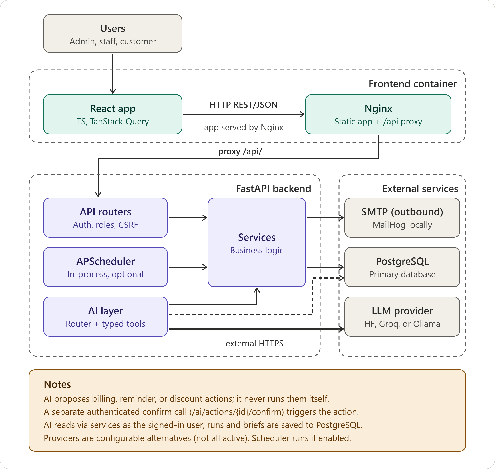
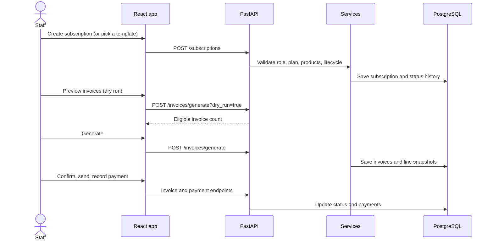
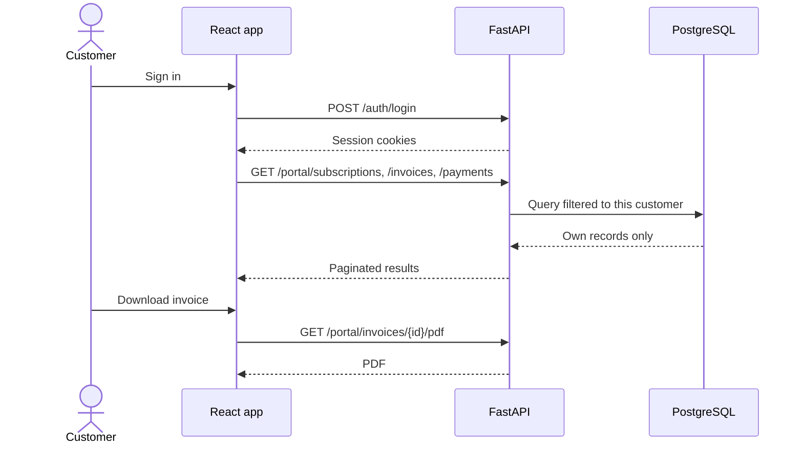
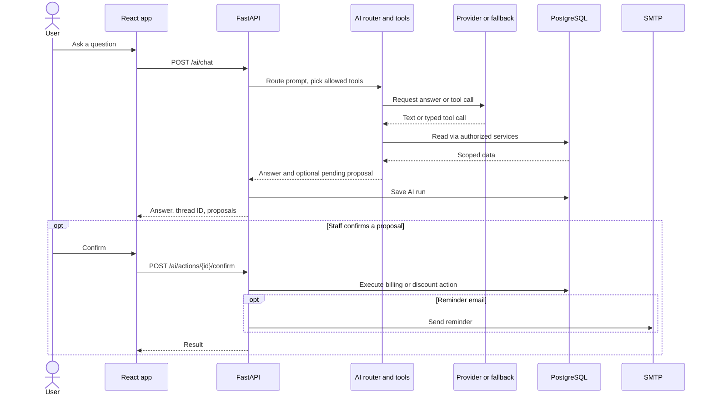
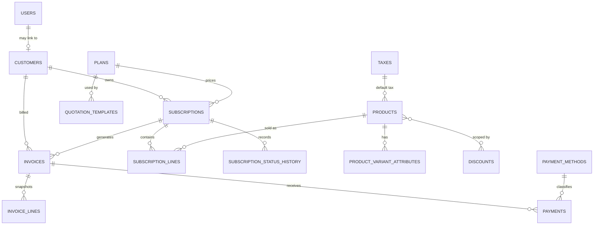

# Revo

**Subscription management and recurring billing in one web app.**

Revo brings customers, product catalogs, subscriptions, invoices, payments, and financial reports together. Staff run billing operations and reporting; customers sign in to a self-service portal to view their own subscriptions, invoices, and payments. A built-in AI assistant answers questions from live Revo data and can prepare actions (billing, reminders, discounts) that a human must confirm before anything happens.

---

## Table of Contents

- [Features](#features)
- [Tech Stack](#tech-stack)
- [Architecture](#architecture)
- [Database Schema](#database-schema)
- [Project Structure](#project-structure)
- [Getting Started](#getting-started)
- [Environment Variables](#environment-variables)
- [API Overview](#api-overview)
- [Testing](#testing)
- [Security Notes](#security-notes)
- [Known Limitations](#known-limitations)
- [Documentation](#documentation)
- [Team Members](#team-members)
- [License](#license)

---

## Features

**Roles:** Admin, Staff, and Customer, enforced across the API and UI.

- **Authentication:** email and password signup, login, token refresh, logout, current-user lookup, and password reset. Admins can create and deactivate staff accounts.
- **Customers:** customer records with customer-scoped data access.
- **Catalog:** products, product variants, taxes, plans, payment methods, quotation templates, and discounts.
- **Subscriptions:** create directly or from a quotation template; move through lifecycle states (quotation, confirmed, active); pause, resume, close, and renew. Every transition is recorded in a status history.
- **Invoicing:** dry-run previews, generation, confirm, cancel, email sending, PDF rendering, and line-item breakdowns. Invoice lines snapshot price, tax, and discount at billing time, so later catalog edits never rewrite past invoices.
- **Payments:** staff-recorded payments and payment history.
- **Reports and dashboard:** revenue, subscriptions, overdue invoices, payments, renewal reminders, and CSV export.
- **Customer portal:** customers see only their own subscriptions, invoices, payments, and invoice PDFs.
- **AI assistant:** specialist routing, permission-scoped data tools, a deterministic fallback when no provider is configured, run history, daily briefs, and confirmation-gated actions.
- **Scheduled jobs:** lifecycle and billing jobs run automatically when the scheduler is enabled.
- **Mock mode:** a frontend-only preview with in-memory data (no persistence, and assistant actions are not executed).

## Tech Stack

| Layer | Technologies |
|---|---|
| **Frontend** | React 19, TypeScript, Vite, React Router, TanStack Query, Tailwind CSS 4, Vitest + Testing Library |
| **Backend** | Python 3.12, FastAPI, Uvicorn, Pydantic 2, SQLAlchemy 2, Alembic |
| **Auth and security** | Argon2 password hashing, PyJWT, HTTP-only cookie sessions, CSRF token |
| **Database** | PostgreSQL 16 |
| **AI** | OpenAI-compatible chat-completions clients for Hugging Face and Groq, optional Ollama |
| **Other backend** | APScheduler (jobs), ReportLab (PDF invoices), Jinja2, SMTP email |
| **DevOps** | Docker Compose, Nginx, MailHog (local email capture), GitHub Actions |
| **Testing** | pytest, pytest-asyncio, HTTPX |

> The AI assistant does not ship its own trained model. Responses come from external provider services (or an Ollama instance you run). Without any provider configured, a deterministic fallback still answers.

## Architecture



**How the pieces fit**

- The browser talks to Nginx, which serves the built React app and proxies `/api/` to FastAPI.
- Routers stay thin: they validate input and role, then delegate to the service layer, which holds the business logic and database access.
- AI tools receive the request's database session and signed-in actor, then call existing Revo services and enforce the same customer and role scope. The AI layer does not expose arbitrary SQL or code execution.
- There is no WebSocket or message broker. The scheduler runs inside the API process.

### Main flows

**1. Staff creates a subscription and bills it**



**2. Customer views their account**



**3. AI assistant answers or proposes an action**



## Database Schema



Other tables: `password_reset_tokens`, `product_variant_values`, `quotation_template_lines`, `quotation_template_line_variants`, `subscription_line_variants`, `discount_products`, `ai_runs`, `briefs`. A full ERD with key fields is in [`docs/erd.md`](docs/erd.md).

## Project Structure

```text
.
├── backend/
│   ├── app/
│   │   ├── ai/            AI routing, providers, tools, runs, briefs
│   │   ├── api/v1/        Versioned FastAPI endpoints
│   │   ├── jobs/          Scheduled and manually triggered jobs
│   │   ├── models/        SQLAlchemy models
│   │   ├── schemas/       Pydantic request/response contracts
│   │   ├── seed/          Demo and bulk fixture data
│   │   ├── services/      Business logic (auth, billing, reports, ...)
│   │   ├── config.py      Settings
│   │   ├── db.py          Engine and session setup
│   │   ├── deps.py        Auth and role dependencies
│   │   └── main.py        App assembly, middleware, routers
│   ├── alembic/           Database migrations
│   ├── scripts/           Performance smoke and Ollama probe scripts
│   └── tests/             API, AI, contract, and seed tests
├── frontend/
│   ├── src/
│   │   ├── api/           API client, TypeScript models, mocks
│   │   ├── app/           Routes, auth context, layout, role guard
│   │   ├── components/    Shared UI components
│   │   └── features/      Screens grouped by product area
│   └── nginx.conf         Static hosting and API proxy
├── docs/                  Architecture, AI, security, performance notes
├── .github/               CI configuration
├── docker-compose.yml     Local multi-service stack
├── .env.example           Environment variable names
└── Makefile               Development commands
```

## Getting Started

### Option 1: Docker Compose (recommended)

**Prerequisites:** Docker Desktop with Docker Compose.

```bash
git clone https://github.com/msnk-dev/Revo.git
cd Revo
cp .env.example .env

docker compose up --build -d
docker compose exec api python -m app.seed.demo
```

The seed command prints generated demo credentials on first run. Copy them from the terminal output.

| Service | Default URL |
|---|---|
| Web app | http://localhost:5173 |
| API docs (Swagger) | http://localhost:8000/docs |
| MailHog (captured emails) | http://localhost:8025 |

Stop everything with `docker compose down`.

### Option 2: Run services separately

**Backend** (Python 3.12 and [`uv`](https://docs.astral.sh/uv/) required):

```bash
cd backend
uv sync --frozen
uv run --frozen alembic upgrade head     # apply migrations to a fresh database
uv run --frozen uvicorn app.main:app --reload
```

Set `DATABASE_URL` and the SMTP variables first. The scheduler is off by default on a host run (`ENABLE_SCHEDULER`).

**Frontend** (Node `^22.22.2`, `^24.15.0`, or `>=26`):

```bash
cd frontend
npm ci
npm run dev
```

The dev server expects a reachable API. To preview the UI with no backend, set `VITE_USE_MOCKS=true`.

Production build: `npm run build`.

## Environment Variables

Copy `.env.example` and fill in your own values. Never commit real secrets.

| Group | Variables |
|---|---|
| **Core** | `APP_NAME`, `APP_ENV`, `APP_CURRENCY`, `APP_SECRET_KEY`, `DATABASE_URL`, `ACCESS_TOKEN_MINUTES`, `REFRESH_TOKEN_DAYS`, `CORS_ORIGINS`, `ENABLE_SCHEDULER` |
| **Email** | `SMTP_HOST`, `SMTP_PORT`, `SMTP_FROM` |
| **AI** | `LLM_PROVIDER_ORDER`, `GROQ_API_KEY`, `GROQ_MODEL`, `GROQ_ROUTER_MODEL`, `HF_TOKEN`, `HF_MODEL`, `OLLAMA_BASE_URL`, `OLLAMA_MODEL`, `OLLAMA_API_KEY`, `LLM_TIMEOUT_S`, `LLM_MAX_RETRIES`, `LLM_DAILY_TOKEN_BUDGET` |
| **Frontend** | `VITE_API_BASE_URL`, `VITE_USE_MOCKS` |
| **Compose ports** | `POSTGRES_PORT`, `MAILHOG_SMTP_PORT`, `MAILHOG_WEB_PORT`, `API_PORT`, `WEB_PORT` |
| **Demo seed** | `REVO_DEMO_ADMIN_PASSWORD`, `REVO_DEMO_CUSTOMER_PASSWORD` |

In production, `APP_SECRET_KEY` must be a private, non-default value.

AI providers are optional. With none configured, the assistant uses its deterministic fallback.

## API Overview

All endpoints are under `/api/v1` (except `GET /health`). Interactive docs are at `/docs` when the API is running. Lists are paginated as `{items, total, page, page_size}`, and errors use an `error` object with `code`, `message`, and `details`.

| Area | Endpoints | Access |
|---|---|---|
| **Auth** | `/auth/signup`, `/login`, `/refresh`, `/logout`, `/forgot`, `/reset`, `/me` | Public / signed in |
| **Staff admin** | `/admin/staff` | Admin |
| **Customers** | `/customers` | Staff, Admin |
| **Catalog** | `/products`, `/products/{id}/variants`, `/taxes`, `/plans`, `/payment-methods`, `/quotation-templates`, `/discounts` | Role checks vary by resource and method; most writes are Admin-only |
| **Subscriptions** | `/subscriptions`, `/subscriptions/from-template/{id}`, `/subscriptions/{id}/transition`, `/subscriptions/{id}/pause`, `/subscriptions/{id}/resume`, `/subscriptions/{id}/close`, `/subscriptions/{id}/renew` | Signed in; role and ownership checks apply |
| **Invoices** | `/invoices`, `/invoices/generate`, `/invoices/{id}/confirm`, `/invoices/{id}/cancel`, `/invoices/{id}/send`, `/invoices/{id}/pdf`, `/invoices/{id}/payments` | Staff, Admin (PDF and list: signed in) |
| **Payments** | `/payments` | Staff, Admin |
| **Reports** | `/reports/summary`, `/reports/subscriptions`, `/reports/revenue`, `/reports/overdue`, `/reports/overdue/summary`, `/reports/payments`, `/reports/renewal-reminders`, `/reports/export.csv` | Staff, Admin |
| **Portal** | `/portal/subscriptions`, `/invoices`, `/payments`, `/invoices/{id}/pdf` | Customer |
| **Jobs** | `/admin/jobs/...` | Admin |
| **AI** | `/ai/route`, `/ai/chat`, `/ai/runs`, `/ai/runs/{id}/explanation`, `/ai/actions/{id}/confirm`, `/ai/actions/{id}/reject`, `/ai/brief/generate`, `/ai/brief/latest` | Signed in / Staff / Admin, depending on endpoint |

Request and response schemas live in `backend/app/schemas/`.

## Testing

```bash
# Backend
cd backend
uv --cache-dir .uv-cache sync --frozen
uv --cache-dir .uv-cache run --frozen pytest

# Frontend
cd frontend
npm test
npm run build
```

Pull requests to `main` run the backend tests and a frontend production build in CI. The repo's [`docs/status.md`](docs/status.md) records 251 backend and 21 frontend tests passing at the time of writing.

**Performance smoke test:** `make seed-bulk` then `make perf`. Results are recorded in [`docs/perf.md`](docs/perf.md) and are specific to that environment.

## Security Notes

- Passwords are hashed with Argon2.
- Sessions use signed access and refresh tokens in HTTP-only cookies; mutations send a CSRF token in `X-CSRF-Token`. Production cookies are marked secure.
- Customer data is scoped server-side from the signed-in user, not from client input.
- AI tools use typed schemas and call existing services under the user's permissions. There is no arbitrary SQL or code execution, and write actions need explicit human confirmation.

## Known Limitations

- **Login throttling is in-memory**, so it is not shared across multiple API workers or replicas.
- **The scheduler runs inside the API process.** Running several API replicas with it enabled could duplicate scheduled work.
- **Production deployment is not included.** The repo covers local Docker Compose only (hosting, TLS, and database operations are up to you).
- **Ollama tool calling is unverified.** A probe script exists (`backend/scripts/`), but no local Ollama model was available during verification.
- **No general-purpose audit log.** Subscription status history and `ai_runs` are the audit records.
- **Mock mode is in-memory only**, and assistant actions are not executed in it.

## Documentation

Further detail is in [`docs/`](docs/): `erd.md`, `ai.md`, `status.md`, `security-review.md`, `perf.md`, `decisions.md`, `contracts.md`.

## Team Members

- Muhammed Shifas NK
- Rithun K P
- Hareesh V
- Ajmal M

## License

No license file is present in the repository. The license is currently unclear.
